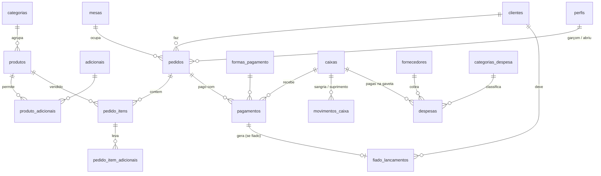

# Banco de dados – Casa Vinte Grill

PostgreSQL no Supabase. São 20 tabelas, 17 funções que o front chama (regras de negócio) e 10 views prontas para as telas.

## Diagrama

## Tabelas

| Área | Tabela | Para que serve |
| --- | --- | --- |
| Config | `configuracoes` | Dados do restaurante, % da taxa de serviço, desconto máximo do caixa, fuso horário |
| Usuários | `perfis` | Liga o login do Supabase ao papel: dono, gerente, caixa, garcom, cozinha |
| Cardápio | `categorias` | Grupos do PDV e para qual setor o pedido vai (cozinha, bar ou nenhum) |
| Cardápio | `produtos` | Preço, custo, unidade (UN ou KG), esgotado, campos fiscais para NFC-e futura |
| Cardápio | `adicionais`, `produto_adicionais` | Extras como "ovo frito" e a quais pratos se aplicam |
| Salão | `mesas` | Mesas físicas |
| Clientes | `clientes` | Cadastro e limite de fiado |
| Vendas | `pedidos` | A comanda: mesa, balcão, delivery, iFood, 99food |
| Vendas | `pedido_itens` | Itens com preço "congelado" na hora da venda e status de preparo (KDS) |
| Vendas | `pagamentos` | Um pedido pode ter vários pagamentos (conta dividida); calcula o troco |
| Caixa | `caixas`, `movimentos_caixa` | Abertura, sangria, suprimento e fechamento com diferença |
| Fiado | `fiado_lancamentos` | Conta corrente do cliente: débitos, pagamentos e ajustes |
| Financeiro | `fornecedores`, `categorias_despesa`, `despesas` | Contas a pagar |
| Controle | `auditoria` | Registro de cancelamentos, descontos, estornos e diferenças de caixa |

## Funções (o back-end chama com `supabase.rpc`)

| Função | Quem pode | O que faz |
| --- | --- | --- |
| `abrir_caixa(p_valor_abertura)` | dono, gerente, caixa | Só um caixa aberto por vez |
| `registrar_movimento_caixa(p_tipo, p_valor, p_motivo)` | dono, gerente, caixa | Sangria ou suprimento |
| `fechar_caixa(p_dinheiro_informado)` | dono, gerente, caixa | Calcula o dinheiro esperado e a diferença |
| `abrir_pedido(p_tipo, p_mesa_id, p_cliente_id, p_nome_cliente, ...)` | todos menos cozinha | Bloqueia duas comandas na mesma mesa |
| `adicionar_item(p_pedido, p_produto, p_quantidade, p_adicionais, p_observacao)` | todos menos cozinha | Valida esgotado, peso/unidade e adicionais |
| `cancelar_item(p_item, p_motivo)` | garçom só o próprio item ainda pendente; demais livre | Auditado |
| `atualizar_status_item(p_item, p_status)` | equipe | preparando, pronto, entregue (KDS) |
| `aplicar_desconto(p_pedido, p_valor, p_motivo)` | caixa até o limite; gerente e dono livre | Auditado |
| `definir_taxas(p_pedido, p_cobrar_servico, p_taxa_entrega)` | todos menos cozinha | Liga/desliga os 10% e define a taxa de entrega |
| `transferir_mesa(p_pedido, p_mesa_destino)` | todos menos cozinha | Troca de mesa |
| `registrar_pagamento(p_pedido, p_forma, p_valor, p_valor_recebido, p_cliente_id)` | dono, gerente, caixa | Pagamento parcial ou total; fecha a comanda ao quitar; fiado respeita o limite |
| `estornar_pagamento(p_pagamento, p_motivo)` | dono, gerente | Reabre a comanda; auditado |
| `cancelar_pedido(p_pedido, p_motivo)` | dono, gerente | Só sem pagamentos; auditado |
| `receber_fiado(p_cliente, p_valor, p_forma)` | dono, gerente, caixa | Cliente quitando a conta |
| `pagar_despesa(p_despesa, p_forma, p_valor_pago, p_do_caixa)` | dono, gerente (caixa se sair da gaveta) | Marca a conta como paga |
| `saldo_fiado(p_cliente)`, `meu_papel()` | equipe | Consultas rápidas |

Totais da comanda (subtotal, 10%, desconto, entrega, total, total pago) são recalculados automaticamente a cada item ou pagamento.

## Views (telas prontas)

| View | Tela |
| --- | --- |
| `vw_mesas` | Mapa de mesas livres e ocupadas, com tempo e valor |
| `vw_pedidos_abertos` | Lista de comandas abertas |
| `vw_kds` | Painel da cozinha, com tempo de espera |
| `vw_resumo_caixas` | Fechamento de caixa por forma de pagamento |
| `vw_painel_hoje` | Painel do dono: vendas do dia, ticket médio, comandas esquecidas (mais de 3h), fiado, contas da semana |
| `vw_vendas_diarias` | Gráfico de vendas por dia |
| `vw_vendas_por_forma` | Vendas por Pix, cartão, dinheiro... |
| `vw_produtos_vendidos` | Ranking de pratos e margem (quando houver custo) |
| `vw_fiado_saldos` | Quem deve e quanto |
| `vw_contas_a_pagar` | Contas vencidas, que vencem hoje e nos próximos 7 dias |

## Segurança

- RLS ligado em todas as tabelas. Visitante sem login (`anon`) não acessa nada.
- O primeiro usuário cadastrado vira **dono**. Os outros entram como garçom **inativo** até o dono liberar e escolher o papel.
- Garçom e cozinha não veem pagamentos, caixa nem financeiro.
- Pedidos, pagamentos e caixa só mudam pelas funções, nunca por `insert`/`update` direto.

## O que ficou de fora de propósito (do sistema antigo)

Cupons, cashback, comissões, agendamentos, DRE, importação de XML, cheque, boleto e vale combustível. A NFC-e tem os campos prontos nos produtos e será integrada depois, por meio de um serviço emissor.
